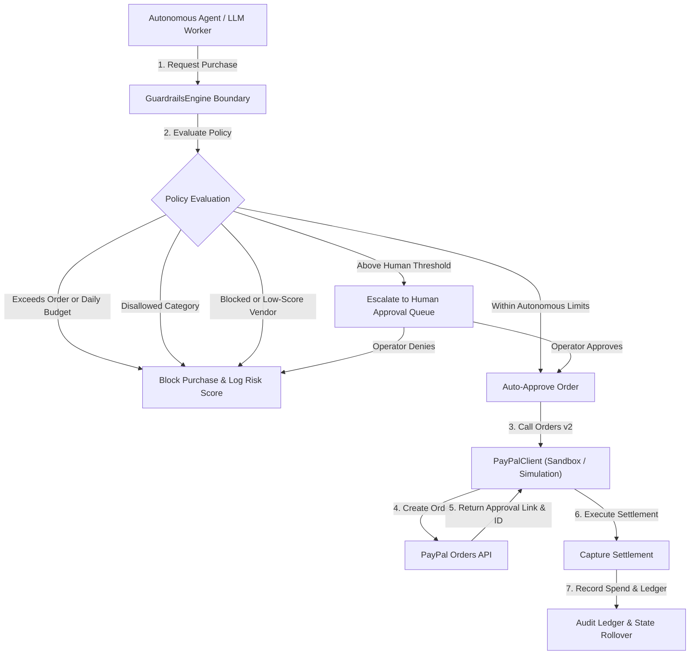

# PayAgent: Autonomous Agentic Commerce Protocol with PayPal Budget Guardrails

[](https://developer.paypal.com)
[](https://www.typescriptlang.org)
[](https://bun.sh)
[](https://opensource.org/licenses/MIT)

PayAgent gives autonomous AI agents the ability to purchase digital goods while enforcing strict, programmatic budget guardrails. Every outgoing transaction passes through real-time policy checks before reaching the PayPal Orders v2 API.

## Problem Statement

Autonomous agents need to buy infrastructure, compute tokens, vector storage, and dataset licenses. Giving an agent unrestricted API access creates severe operational risks:
- Token-burning loops that exhaust corporate accounts.
- Prompt injection attacks directing funds to unverified merchant addresses.
- Accidental purchases from disreputable or untrusted vendors.
- Lack of auditability for financial actions taken by autonomous models.

PayAgent solves this problem by inserting a deterministic policy boundary between the LLM decision loop and the payment gateway.

## Architecture

The diagram shows how PayAgent evaluates purchase requests before creating or capturing PayPal orders.



## Key Innovations

### 1. Programmatic Guardrail Shield
The engine enforces multi-layered spending controls:
- Single-order maximum cap ($35.00 default).
- Aggregate 24-hour spend ceiling ($150.00 default) with automatic date rollover.
- Category whitelist covering cloud compute, API tokens, vector storage, dataset licensing, and domain registration.
- Vendor reputation scoring with an automated security blocklist.

### 2. PayPal Orders v2 Sandbox Integration & Dual-Mode Simulation
`PayPalClient` talks directly to the official PayPal Orders v2 REST endpoints. When sandbox credentials are not present, the client activates an internal high-fidelity sandbox simulation. This enables end-to-end testing, local development, and CI runs without external network dependencies.

### 3. Human-in-the-Loop Thresholding & Escalation
Transactions within autonomous boundaries settle instantly. Any purchase exceeding the configured human threshold ($25.00 default) pauses execution and generates a structured escalation payload with a PayPal approval URL. The agent cannot proceed until an operator approves.

### 4. Real-time Audit Ledger & Cryptographic Verification
Every transaction records a structured schema containing policy verification details, risk scores, merchant IDs, PayPal order identifiers, and settlement timestamps. This provides complete compliance tracking for autonomous workflows.

## Quickstart Guide

### Prerequisites
Install Bun on your workstation:
```bash
curl -fsSL https://bun.sh/install | bash
```

### Installation
Clone the repository and install dependencies:
```bash
cd /home/codenuclei/payagent
bun install
```

### Configuration
Set your PayPal Sandbox credentials in your environment, or run without them to use the built-in simulation mode:
```bash
export PAYPAL_CLIENT_ID="your_sandbox_client_id"
export PAYPAL_CLIENT_SECRET="your_sandbox_client_secret"
```

### Run Dev Server
Start the development server with live reload:
```bash
bun dev
```

### Run CLI Demo
Execute the interactive demonstration of agent purchases, guardrail rejections, and PayPal sandbox captures:
```bash
bun demo
```

### Run Test Suite
Execute the test runner:
```bash
bun test
```

## API Documentation

### GuardrailsEngine
```typescript
import { GuardrailsEngine } from "./src/agent/guardrails";

const engine = new GuardrailsEngine({
  maxOrderBudgetUSD: 35.0,
  dailySpendLimitUSD: 150.0,
  requireHumanApprovalAboveUSD: 25.0,
  allowedCategories: ["cloud_compute", "api_tokens"],
  blockedVendors: ["darkweb-api"],
  minVendorScore: 70,
});

const result = engine.evaluatePurchase({
  amountUSD: 18.50,
  category: "api_tokens",
  vendorId: "anthropic-inc",
  vendorReputationScore: 95,
});

if (result.passed && !result.requiresHumanApproval) {
  // Safe to proceed with PayPal checkout
}
```

### PayPalClient
```typescript
import { PayPalClient } from "./src/paypal/client";

const client = new PayPalClient();

const order = await client.createOrder({
  intent: "CAPTURE",
  purchase_units: [
    {
      reference_id: "PU-101",
      description: "Cloud compute GPU cluster burst",
      amount: { currency_code: "USD", value: "18.50" },
    },
  ],
});

const captured = await client.captureOrder(order.id);
console.log(captured.status); // "COMPLETED"
```

## Hackathon Track Alignment

### Best Use of Agentic Commerce
PayAgent provides the missing financial governance layer for autonomous commerce. Agents can autonomously replenish their own computing resources and APIs without unbounded corporate card access.

### Best Use of PayPal + AI
PayAgent demonstrates production-grade integration with the PayPal Orders v2 API. It links machine intelligence with PayPal checkout, providing fraud prevention, risk scoring, and human escalation.
